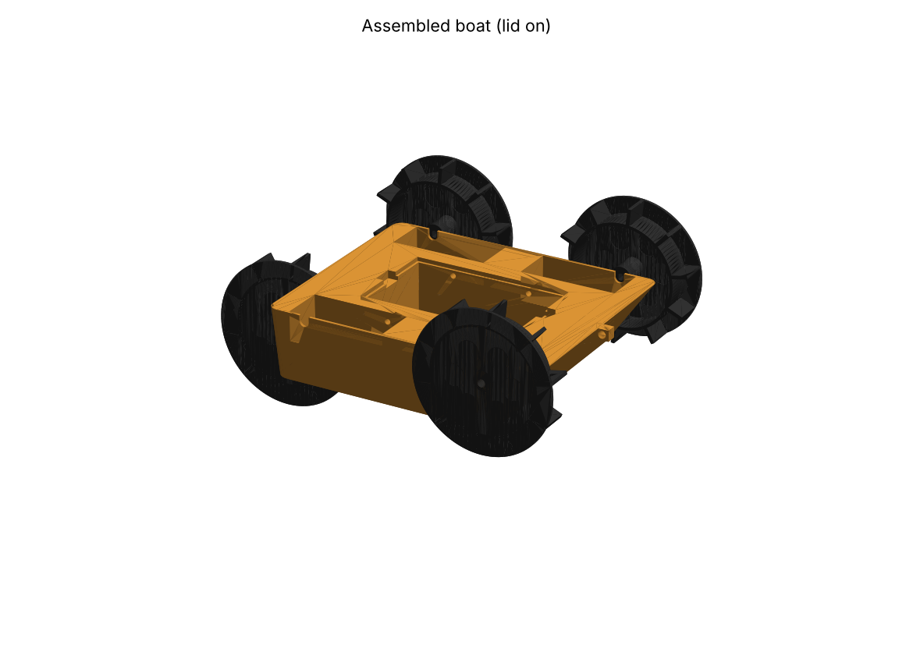
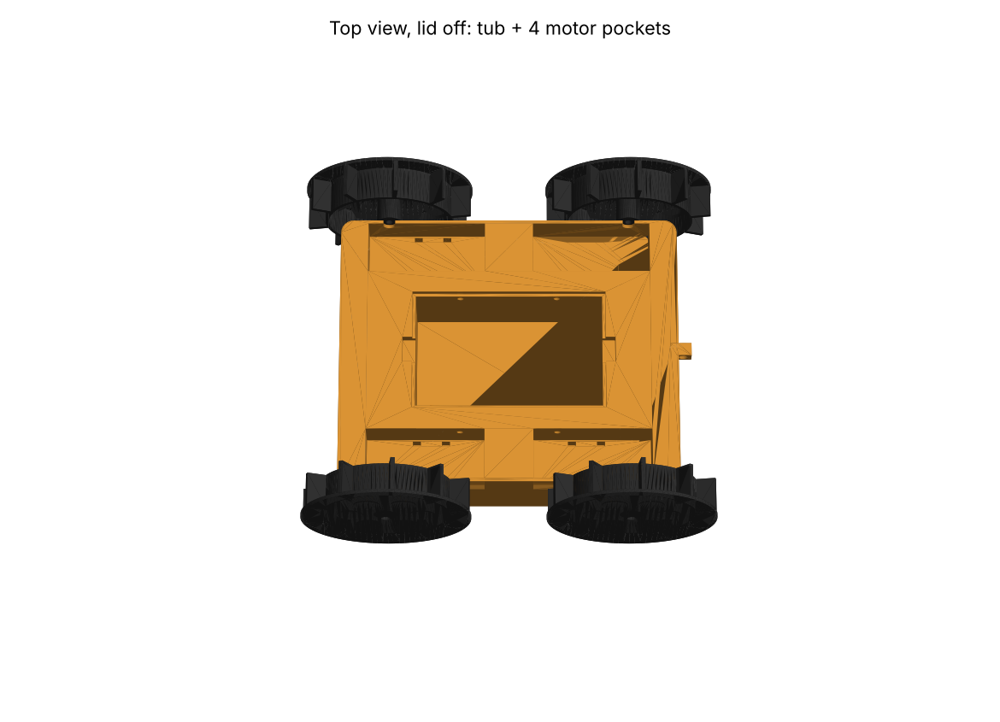
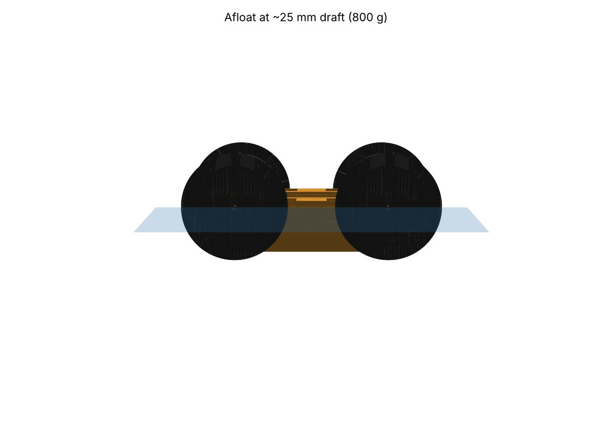

# AMPHIBOAT: low-cost 3D-printed amphibious boat (land + water)

A 4-wheel-drive, flat-bottomed tri-hull boat. Its four printed **cupped paddle wheels** roll on land and paddle in water. You steer it like a tank (skid steering) from a phone over Wi-Fi. There are 3 different printed parts (7 prints in total) and about ₱1,050 (≈ US$18) of parts.



## 1. Competition guidelines

I couldn't find any published OCNR rulebook, either online or in the connected Google Drive. Before you print, check the design against the official sheet. I built it to the usual student "3D-printed boat / amphibious vehicle" rules:

| Assumed rule | How this design meets it |
|---|---|
| Hull must be 3D printed | Hull, lid and all 4 wheels are printed (PLA or PETG) |
| Fits a standard printer | Largest part is 218 × 172 × 50 mm and fits a 220 × 220 bed (Ender-3 class) |
| Must travel on land and in water | The same paddle wheels drive in both, with no conversion |
| Must float and stay stable | ~800 g total, ~25 mm draft, 50 mm hull, reserve buoyancy ≈ 1.6 kg (2× the boat's weight) |
| Remote-controlled, electric, low voltage | 4×AA (6 V), ESP32 Wi-Fi phone control, automatic stop on signal loss |
| Low cost | ≈ ₱1,050 total, see BOM |
| Electronics must stay dry | Sealed central tub with a drop-in lid, taped joint, and hot-glued wire tunnels |

If the official rules set a different size limit, change the parameters at the top of `cad/generate.py` and run it again (see §7).

## 2. Design overview

| Item | Value |
|---|---|
| Hull (L × W × H) | 218 × 172 × 50 mm, flat bottom, bow raked 35° to climb out of the water onto banks |
| Overall size with wheels | ≈ 254 × 217 × 98 mm |
| Wheels | 4 × Ø104 mm cupped paddle wheels, 10 paddles, 22 mm wide |
| Wheelbase / track | 150 mm / 195 mm |
| Ground clearance | 6 mm under the hull (paddle tips act as grousers on sand and grass) |
| Drive | 4 × TT 1:48 gear motors, left pair and right pair in parallel |
| Mass (est.) | hull ~320 g, wheels 4×43 g, lid 35 g, motors 120 g, batteries 110 g, electronics 40 g ≈ **800 g** |
| Draft at 800 g | ~25 mm (motor pocket floors at 28 mm, shaft notches at 42 mm stay above the water) |
| Paddle immersion afloat | ~31 mm of the 52 mm wheel radius |

**Why it works on both surfaces:**
- **Land:** the outer flange and the paddle tips make a lugged tyre. 4WD with skid steering handles sand, grass and the ramp out of the water.
- **Water:** the lower third of each wheel is underwater. The cupped paddles (flange on the outboard side) push water backward like a paddle steamer. Spinning one side faster than the other turns the boat.
- **Floating:** the slicer prints the solid pontoons as closed air chambers (walls plus low infill). The sealed central tub adds buoyancy and keeps the batteries low for a low centre of gravity.

Draft vs. load (from the CAD hull volume):

| Total mass | 600 g | 700 g | 800 g | 1.5 kg |
|---|---|---|---|---|
| Draft | 20 mm | 23 mm | 26 mm | 46 mm |




## 3. Files

| File | Qty | Notes |
|---|---|---|
| `stl/hull.stl` | 1 | Print upright, no supports |
| `stl/lid.stl` | 1 | Print plate-down, no supports |
| `stl/paddle_wheel_x4.stl` | 4 | Print flange-down, no supports |
| `stl/assembly_preview_DO_NOT_PRINT.stl` | – | For viewing and presentation only |
| `cad/generate.py` | – | Parametric source (Python + manifold3d) |
| `cad/render.py` | – | Makes the renders and the assembly preview |
| `firmware/amphiboat/amphiboat.ino` | – | ESP32 Wi-Fi phone control |

## 4. Print settings (watertight)

| Setting | Value |
|---|---|
| Material | PETG (best for water) or PLA |
| Layer height | 0.2–0.28 mm |
| Walls / perimeters | **3** (hull), 2 (wheels, lid) |
| Top / bottom layers | **5 / 5** |
| Infill | 8–10 % gyroid (hull). Low infill is what makes the pontoons sealed air chambers |
| Supports | None |
| Extra | Hull: 105 % flow, or one layer of brush-on epoxy/varnish on the outside for a guaranteed seal |

Print time is about 14–18 h for the hull and 2 h per wheel. Filament is about 520 g in total (≈ ₱400).

**Leak test the bare hull first.** Push it under water for 1 minute. If you see a stream of bubbles, coat that area with epoxy or nail polish.

## 5. Bill of materials (Philippine online prices, approx.)

| Part | Qty | ₱ |
|---|---|---|
| PLA/PETG filament (~520 g) | 1 | 400 |
| TT gear motor 1:48, 3–6 V (double shaft) | 4 | 180 |
| ESP32 DevKit V1 | 1 | 250 |
| TB6612FNG motor driver (or L298N) | 1 | 90 |
| 4×AA battery holder with switch | 1 | 35 |
| AA batteries (or NiMH rechargeables) | 4 | 60 |
| M2 × 10 self-tapping screws | 4 | 10 |
| Zip ties, jumper wire, electrical tape, hot glue | – | 40 |
| **Total** | | **≈ ₱1,065** |

## 6. Assembly

1. **Motors:** lay each TT motor in its deck pocket with the gearbox at the outer wall. The shaft drops into the U-notch. Fix it with one zip tie through each pair of slots in the pocket floor. If the shaft sits low, shim under the motor with scrap plastic until it sits in the notch.
2. **Wires:** run each motor's leads through the Ø4.4 tunnel into the central tub. Seal both ends of every tunnel with hot glue.
3. **Wheels:** push each wheel onto its shaft, hub toward the hull, leaving a 0.5 mm gap. Drive an M2 × 10 screw through the outer access hole into the shaft's centre hole.
4. **Electronics in the tub:** put the battery pack flat on the floor (zip tie it through the floor slots) and the ESP32 and driver on top. Wire as below.
5. **Seal:** put the lid on, then run electrical tape around the lid seam. Grease the shaft notches (petroleum jelly) to stop splash getting in.
6. Put a pinch of ballast (coins) in the tub if the boat trims nose-up.

**Wiring (TB6612FNG):**

| TB6612 | Connects to |
|---|---|
| VM | Battery + (6 V, after the switch) |
| VCC | ESP32 3V3 |
| GND | Battery −, ESP32 GND |
| STBY | ESP32 GPIO33 |
| AIN1 / AIN2 / PWMA | GPIO26 / GPIO25 / GPIO27 |
| BIN1 / BIN2 / PWMB | GPIO14 / GPIO12 / GPIO13 |
| AO1 / AO2 | Both LEFT motors in parallel |
| BO1 / BO2 | Both RIGHT motors in parallel |
| ESP32 VIN | Battery + (6 V) |

If one side runs backwards, swap that side's two motor wires.

## 7. Control

1. Flash `firmware/amphiboat/amphiboat.ino` from the Arduino IDE (board: "ESP32 Dev Module").
2. Connect your phone to Wi-Fi **AMPHIBOAT** with password **boat1234**.
3. Open **http://192.168.4.1** and drag the joystick.

The motors stop automatically if the phone link drops for 0.6 s.

## 8. Changing the design

Every dimension is a parameter at the top of `cad/generate.py` (hull length, beam, height, wheel size, motor pocket position). To rebuild:

```
pip install manifold3d trimesh numpy matplotlib
cd cad
python generate.py   # writes stl/*.stl
python render.py     # writes renders/*.png and the assembly preview
```

The TT motor's shaft height varies by brand. `SHAFT_Z` (46 mm) and `POCKET_FLOOR_Z` (28 mm) set it. Measure your motor and adjust them if they don't match.
