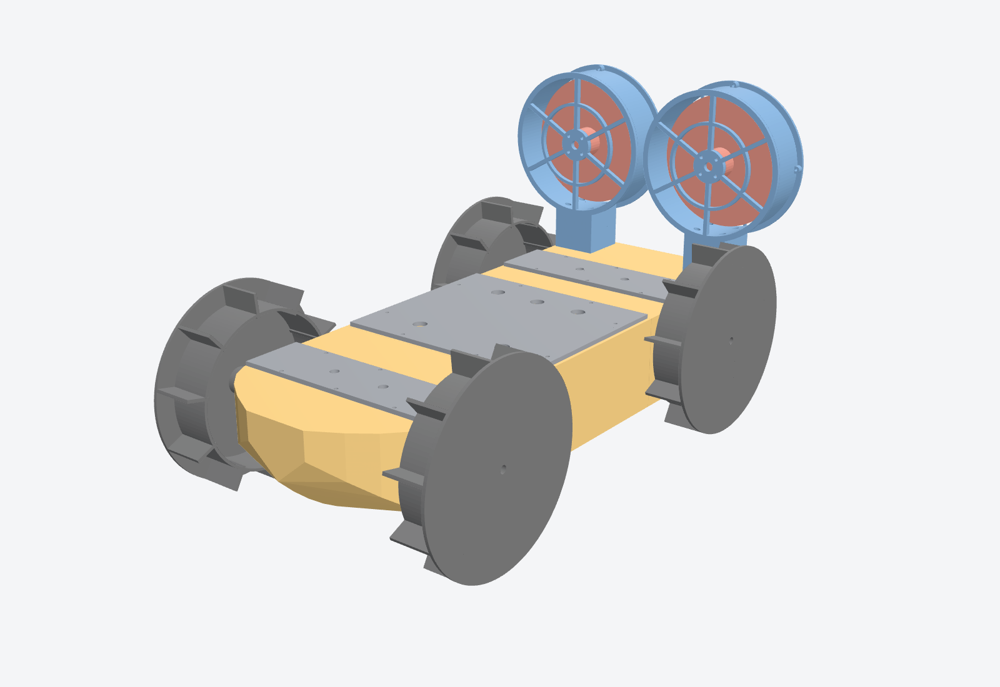
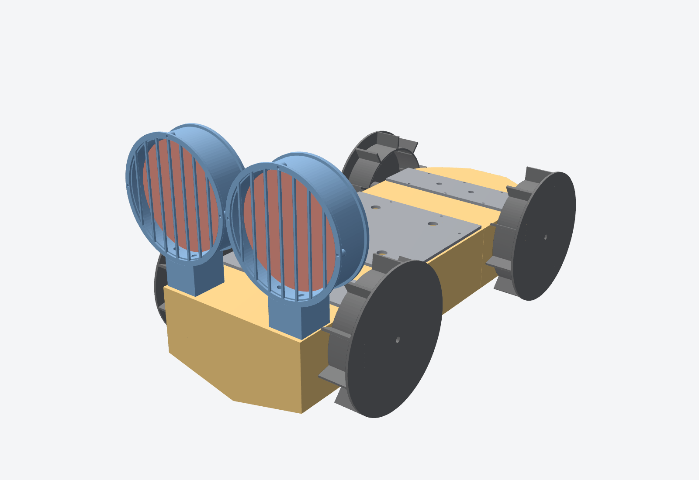
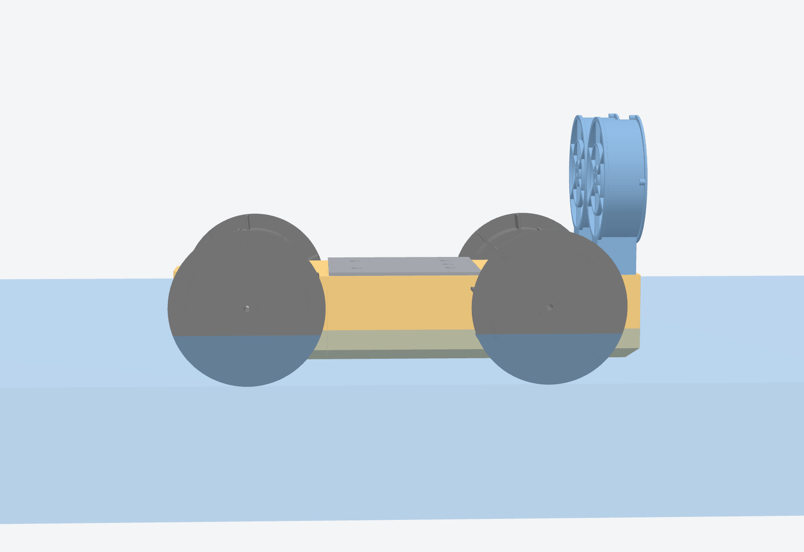

# OVERPOWERED AMPHIBOAT

An airboat plus 4WD amphibian. Two ducted 5-inch FPV-drone motors push it across water, mud and land. Four 37 mm gear motors drive Ø176 mm paddle wheels for grip on land and extra push in water. You drive it with a FlySky RC transmitter.



## Specifications (from the CAD model; thrust and speed are estimates)

| Item | Value |
|---|---|
| Hull | V-bottom planing hull, 540 × 200 × 110 mm, 3 sealed printed segments |
| Overall size | 540 L × 300 W × 300 H mm |
| Dry mass | ≈ 3.4 kg (2.0 kg printed parts) |
| Buoyancy | 9.9 kg to the deck. Sits 48 mm deep, so the wheel motors are 12 mm above the water |
| Water propulsion | 2 × 2306 2450 KV motors with 5" tri-blade props on 4S. Typical bench thrust is about 1.1–1.4 kg each, so ≈ 2.2–2.8 kg total, roughly 0.7× the boat's weight |
| Land drive | 4 × JGB37-520 12 V 330 rpm motors. ≈ 3 m/s no-load with Ø176 mm wheels, plus the fan thrust |
| Ground clearance | 10 mm |
| Steering | Differential fan thrust on water, tank steering on land; both work at the same time |
| Battery | 4S 2200 mAh 50C LiPo. About 2 min at full throttle, about 8–10 min mixed driving (a 4S 3000–5000 mAh pack runs longer) |



## Materials (approximate Philippine prices, October 2026; confirm with the seller)

Suppliers:
- **MakerLab Electronics** ([makerlab.ph](https://makerlab.ph)): Arduino, BTS7960 drivers, gear motors, buck converter, filament.
- **FPV and RC hobby shops** on Shopee/Lazada: transmitter, FPV motors, ESCs, props, LiPo.
- **Hardware stores:** screws, epoxy.

| Part | Qty | ₱ |
|---|---|---|
| 2306 2450 KV FPV motor (one CW, one CCW) | 2 | 1,800 |
| 30 A BLHeli_S/BLHeli_32 ESC | 2 | 1,200 |
| 5" tri-blade props (2 CW + 2 CCW, plus a spare set) | 1 set | 300 |
| JGB37-520 gear motor, 12 V 330 rpm | 4 | 2,200 |
| BTS7960 43 A motor driver | 2 | 700 |
| Arduino Nano | 1 | 250 |
| FlySky FS-i6 transmitter + FS-iA6B receiver | 1 | 3,000 |
| 4S 2200 mAh 50C LiPo (XT60) + LiPo-safe bag | 1 | 1,850 |
| LiPo balance charger with power supply | 1 | 1,500 |
| LM2596 buck converter set to 5.0 V (Nano + receiver) | 1 | 100 |
| XT60 plugs, XT60 arming loop, 14 AWG silicone wire | 1 set | 400 |
| PG7 cable glands | 5 | 100 |
| PETG filament (2.0 kg used) | 2.5 kg | 2,125 |
| M3 screws (8–20 mm) + nuts, 2-part epoxy, foam gasket tape | 1 | 580 |
| **Total** | | **≈ ₱16,100** |

## Printed parts (`stl/`)

Every part fits a 220 × 220 mm bed and none needs supports.

Print settings (PETG):
- **Hull segments:** 3 walls, 5 top and 5 bottom layers, 5% gyroid infill. Each segment is then its own sealed buoyancy chamber.
- **Wheels and ducts:** 3 walls, 20% infill.

| File | Qty | Size (mm) | g (all copies) |
|---|---|---|---|
| `hull_bow.stl`, `hull_mid.stl`, `hull_stern.stl` | 1 each | 180 × 200 × 110 | 1,180 |
| `dowel.stl` | 8 | 6 × 6 × 22 | 4 |
| `bay_lid.stl` | 1 | 176 × 194 × 10 | 93 |
| `pocket_cover.stl` (also clamps the motors) | 2 | 56 × 196 × 44 | 127 |
| `wheel.stl` | 4 | 176 × 176 × 40 | 450 |
| `fan_duct_port.stl`, `fan_duct_stbd.stl` | 1 each | 183 × 148 × 45 | 162 |
| `rear_guard.stl` | 2 | 148 × 148 × 2.5 | 29 |

## Build

1. **Hull.** Leak-test each segment under water for 60 s. Join the segments with the dowels and epoxy (4 per joint), then brush a thin epoxy coat over the outside.
2. **Wheel motors.** Put each JGB37 in its pocket, shaft through the Ø13 hole in the side wall. Fit 2 × M3 face screws (the slots sit at ±15.5 mm; drill to match your gearbox). Screw the pocket covers down; their saddles clamp the motors. Fit the wheels with the hub facing the hull and 2 × M3 grub screws on the shaft flat.
3. **Fans.** Bolt each duct to the stern (4 × M3 × 25). Mount the 2306 motor on the spider, behind the hub (16 × 16 mm M3 pattern). Fit the prop so it pushes air aft. Use a CW motor and prop on one side and CCW on the other. Screw the rear guards onto the duct ends.
4. **Electronics** go in the mid-segment bay: LiPo, 2 ESCs, 2 BTS7960s, Nano, receiver, buck converter. Pass the wires through the PG7 glands in the lid and seal them with hot glue. Put gasket tape in the lid groove and screw the lid down (8 × M3).

## Wiring

| From | To |
|---|---|
| LiPo XT60 → arming loop | 4S main bus (14 AWG) |
| Main bus | ESC L + ESC R power, BTS7960 L + R B+/B-, LM2596 input |
| ESC L / ESC R motor wires | port / starboard 2306 (swap any 2 wires to reverse) |
| ESC signal L / R | Nano D9 / D10 (ESC GND to Nano GND) |
| BTS7960 (left) RPWM / LPWM | D5 / D6. M+/M- go to both port wheel motors in parallel |
| BTS7960 (right) RPWM / LPWM | D3 / D11. M+/M- go to both starboard wheel motors in parallel |
| BTS7960 R_EN, L_EN, VCC / GND | Nano 5 V / GND |
| LM2596 5.0 V | Nano 5 V + receiver 5 V |
| FS-iA6B iBUS signal | Nano D0 (RX). Unplug it while uploading |

Flash `firmware/op_amphiboat/op_amphiboat.ino` from the Arduino IDE (board: Arduino Nano).

**Controls (mode 2):**
- Right stick: steering and wheel speed.
- Left stick up and down: fan throttle.
- Switch A: arms the fans. They only arm while the fan stick is at the bottom.
- VrA knob: wheel power limit.

The wheel output is capped at 75%, which keeps the 12 V motors near 12 V on a 4S pack. If the radio signal is lost for 250 ms, the firmware stops everything. Also set the receiver's own failsafe in the FS-i6 to throttle low.



## Safety

- 5" props at full throttle can cut fingers. Remove the props whenever you work on the boat powered up. Pull the arming loop before you touch it. Keep both guards on.
- Charge the LiPo only on a balance charger, inside a LiPo bag, while someone watches. Never charge it in the boat. Never discharge below 3.5 V per cell.
- Drive in open water away from people. Check your event's and venue's rules on propeller craft.

## Rebuild the CAD

```
pip install manifold3d trimesh numpy
cd cad && python generate.py
```

This writes the STLs, `renders/assembly.glb` and `cad/stats.json` (mass, draft, part clash list, bed-fit check). Every dimension is a constant at the top of `generate.py`.
