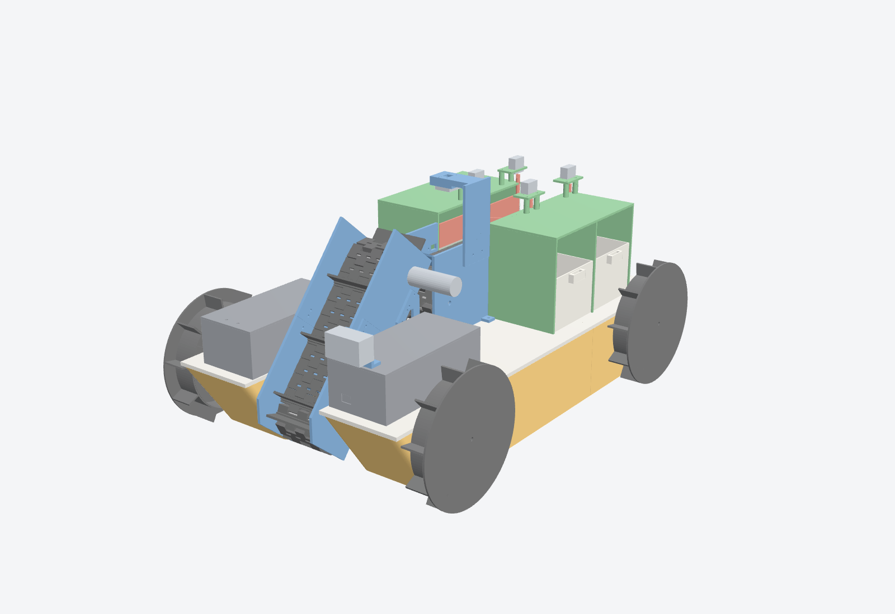
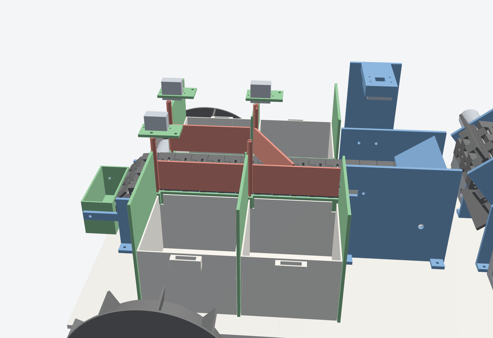
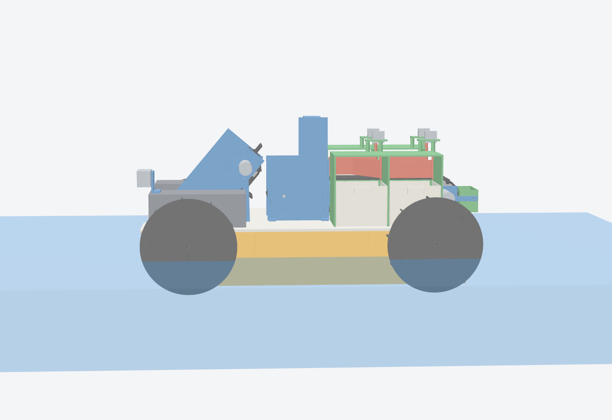
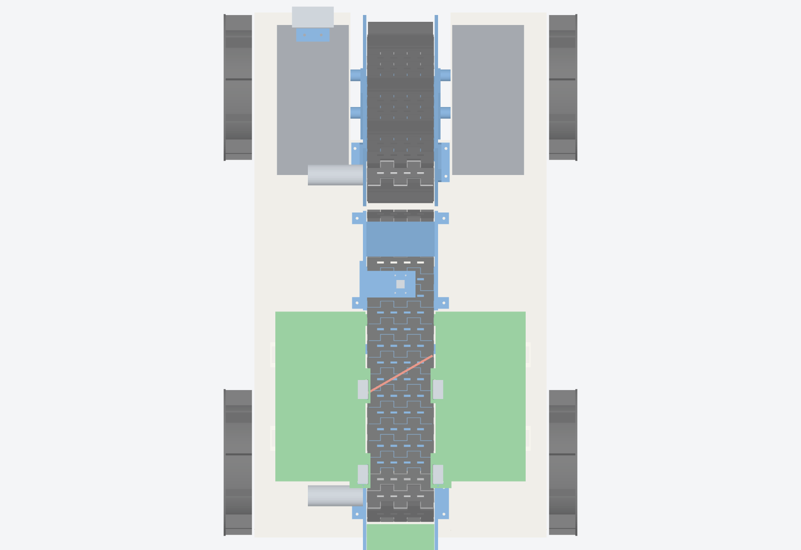
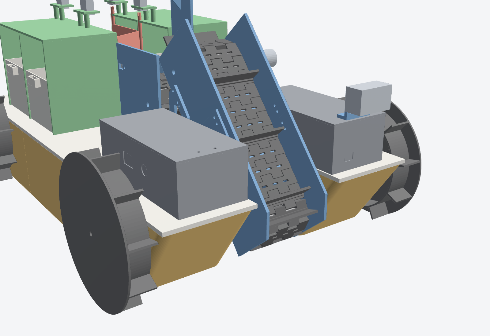

# Trash-sorting amphibious boat

A 3D-printed catamaran that scoops floating trash with a conveyor at the bow, carries it up onto a second conveyor where a camera identifies it, then sorts it into 4 bins. Each bin is opened and closed by its own servo (4 servos total). A second camera at the bow streams live video to your phone for steering. The boat keeps the paddle-wheel drive from the first design, so it still drives on land as well as in water.



## 1. How it works

1. **Intake conveyor (C1).** The conveyor sits between the two pontoons at a 50° angle. Its lower drum sits just below the waterline. Cleats every 4th link scoop floating items up out of the water, and holes in every link let the water drain.
2. **Transfer chute.** At the top, items slide down a short chute onto the sorting conveyor.
3. **Sorting conveyor (C2).** This conveyor runs flat toward the stern. An IR sensor stops both conveyors when an item reaches the camera zone. The Pi camera looks down from 108 mm above the belt, with an LED strip for even light, and classifies the item on 5 frames. The majority vote picks the bin.
4. **Sorting into bins.** Each bin is a box beside the belt with a door (flap) in its side wall. The door's servo swings it 60° across the belt. The moving belt pushes the item along the open door and into the bin, then the servo closes the door again. If the camera isn't sure (below 70% confidence), the item goes to bin 4 ("Other"). Anything that gets past every door falls into the reject tray at the stern.
5. **Steering.** You drive from a phone browser on the Pi's Wi-Fi. The page shows the navigation camera live, has a joystick and per-bin counters, and lets you open any bin by hand and unjam the intake. The drive motors stop if the phone link drops for 0.8 s.



## 2. Guidelines used

I still couldn't find a published OCNR rulebook. The design follows the brief you gave earlier, plus this request:

- 3D-printed boat that runs on land and in water.
- Front conveyor that collects trash.
- Camera on a second, top conveyor that sorts into up to 4 containers.
- Only 4 servos, all used to open and close the containers.
- A front-facing navigation camera.
- Parts available from MakerLab Electronics (makerlab.ph) or other local suppliers.

Check the size, weight and power limits against the official OCNR sheet.

## 3. Specifications (computed from the CAD model)

| Item | Value |
|---|---|
| Hull | Catamaran, 2 pontoons of 630 × 115 × 100 mm, each printed as 3 sealed segments |
| Overall size | 650 L × 424 W × 315 H mm (on land) |
| Dry mass | ≈ 6.2 kg (≈ 4.1 kg printed parts, 2.1 kg bought parts) |
| Buoyancy | 13.1 kg to the deck, about 2× the boat's weight |
| Draft (how deep it sits) | 48 mm dry, 52 mm with 500 g of trash. The drive motors sit at 65 mm, so they stay 13 mm above the water |
| Stability | Metacentric height ≈ 190 mm (very stable, because the pontoons are far apart) |
| Drive | 4 × JGA25-370 12 V 60 rpm motors with Ø176 mm paddle wheels, tank steering. Ground clearance 10 mm |
| Intake belt C1 | 80 mm wide printed link belt, 29 links (7 with cleats), 50° incline, ≈ 64 mm/s |
| Sorting belt C2 | 80 mm wide, 39 links, 310 mm between drums, ≈ 56 mm/s |
| Bins | 4 removable buckets, each 93 × 99 × 74 mm inside (≈ 0.65 L) |
| Item size | Up to about 75 mm wide, 70 mm long and 50 mm tall: caps, small bottles, cans, cups, wrappers, foam |
| Electronics | Raspberry Pi 4, Pi camera (sorting), USB webcam (navigation), PCA9685 servo board, 2 × L298N, 3S2P 18650 battery |
| Run time | About 2 h on a 3S2P pack, at roughly 2 A average |



## 4. Materials list and local suppliers

Prices are approximate Philippine online prices (October 2026). Only the Raspberry Pi 4 price is confirmed: MakerLab lists the Pi 4 from ₱5,990. Check the others with the store before you buy.

**Suppliers:**
- **MakerLab Electronics** ([makerlab.ph](https://makerlab.ph), also on Shopee and Lazada): Raspberry Pi, cameras, motors, drivers, servos, filament.
- **Circuitrocks** ([circuit.rocks](https://circuit.rocks/collections/raspberry-pi-4)): Raspberry Pi and cameras.
- **e-Gizmo Mechatronix Central:** motor drivers, sensors, batteries.
- **Hardware stores** (Ace Hardware, Wilcon Depot, Handyman): threaded rod, screws, epoxy.
- **Sign shops:** Sintra (PVC foam) board.

### Electronics

| Part | Qty | Approx. ₱ | Where |
|---|---|---|---|
| Raspberry Pi 4 Model B 4 GB | 1 | 5,990 | MakerLab, Circuitrocks |
| microSD card 32 GB (Raspberry Pi OS 64-bit) | 1 | 350 | any |
| Pi camera module OV5647 5 MP + 30 cm ribbon (sorting camera) | 1 | 450 | MakerLab, Circuitrocks |
| USB webcam 720p (navigation camera) | 1 | 550 | any computer shop |
| PCA9685 16-channel servo driver | 1 | 250 | MakerLab, e-Gizmo |
| MG90S metal-gear micro servo (bin doors) | 4 | 720 | MakerLab |
| L298N dual motor driver (1 for drive, 1 for conveyors) | 2 | 300 | MakerLab, e-Gizmo |
| JGA25-370 gear motor, 12 V, 60 rpm (wheels) | 4 | 1,800 | MakerLab, Shopee |
| JGA25-370 gear motor, 12 V, 30 rpm (conveyors) | 2 | 900 | MakerLab, Shopee |
| XL4015 5 A buck converter, set to 5.1 V (Pi) | 1 | 200 | MakerLab |
| LM2596 buck converter, set to 5.5 V (servos + LEDs) | 1 | 100 | MakerLab |
| FC-51 IR obstacle sensor (item at camera) | 1 | 50 | MakerLab, e-Gizmo |
| 5 V white LED strip, 20 cm (camera lighting) | 1 | 80 | any |
| 18650 Li-ion cells, genuine 2,500 mAh | 6 | 1,500 | e-Gizmo, battery shops |
| 3S 20 A BMS + nickel strip | 1 | 150 | e-Gizmo, Shopee |
| 12.6 V 2 A Li-ion charger + DC jack | 1 | 350 | Shopee |
| Rocker switch, inline blade fuse holder + 10 A fuse | 1 | 120 | any |
| Hook-up wire, Dupont jumpers, JST plugs, heat shrink | 1 set | 300 | any |
| **Electronics subtotal** | | **≈ 14,160** | |

### Mechanical

| Part | Qty | Approx. ₱ | Where |
|---|---|---|---|
| PETG filament, 1.75 mm (4.1 kg used) | 5 kg | 4,250 | MakerLab |
| Sintra (PVC foam) board, 5 mm, piece at least 650 × 370 mm (deck) | 1 | 400 | sign shop, Lazada |
| M6 threaded rod, 1 m (4 drum axles) + 12 M6 nuts and washers | 1 | 150 | hardware store |
| M3 screw and nut assortment (8–20 mm) | 1 | 250 | hardware store, MakerLab |
| M2 screws (servo tabs, horns) + 6 × M3 grub screws | 1 | 110 | MakerLab |
| Two-part epoxy (sealing segment joints, coating pontoons) | 1 | 250 | hardware store |
| Hot glue sticks, electrical tape, petroleum jelly | 1 | 130 | any |
| **Mechanical subtotal** | | **≈ 5,540** | |
| **Total** | | **≈ ₱19,700** | |

The belt pins are 84 mm pieces of the same PETG filament, so they cost nothing extra. The Pi 4 is about 30% of the total cost.

## 5. Printed parts (`stl/`)

PETG is best for water. Use 2–3 walls and 15% infill, except the pontoons, which take 3 walls, 5 top and 5 bottom layers, and 5% gyroid infill. Each pontoon segment then prints as its own sealed air chamber, so one leak won't sink the boat. No part needs supports. Every part fits a 220 × 220 mm bed (Ender-3 class). The renders and `stl/assembly_preview_DO_NOT_PRINT.stl` are for viewing only.

| File | Qty | Size (mm) | Filament (g, all copies) | Note |
|---|---|---|---|---|
| `pontoon_bow_port.stl`, `pontoon_bow_stbd.stl` | 1 + 1 | 210 × 115 × 100 | 444 | |
| `pontoon_mid.stl` | 2 | 210 × 115 × 100 | 516 | one per side |
| `pontoon_stern_port.stl`, `pontoon_stern_stbd.stl` | 1 + 1 | 210 × 115 × 100 | 490 | |
| `dowel.stl` | 8 | 6 × 6 × 22 | 4 | segment alignment |
| `motor_saddle.stl` | 4 | 26 × 40 × 22 | 26 | |
| `paddle_wheel.stl` | 4 | 176 × 176 × 34 | 411 | |
| `belt_link.stl` | 61 | 27 × 10 × 80 | 378 | print on edge, as exported |
| `belt_link_cleat.stl` | 7 | 27 × 30 × 80 | 70 | intake belt, every 4th link |
| `drum_drive.stl` | 2 | 54 × 54 × 81 | 95 | |
| `drum_idler.stl` | 2 | 54 × 54 × 81 | 96 | |
| `c1_frame_lower.stl`, `c1_frame_upper.stl` | 1 + 1 | 120 × 96 × 137 | 216 | intake frame halves |
| `c1_splice.stl` | 2 | 46 × 73 × 3 | 16 | joins the halves |
| `c1_leg_port.stl`, `c1_leg_stbd.stl` | 1 + 1 | 47 × 91 × 14 | 17 | |
| `c2_front_frame.stl` | 1 | 116 × 120 × 120 | 117 | tail drum, camera-zone walls, chute |
| `c2_bed_beam.stl` | 1 | 192 × 84 × 41 | 127 | |
| `c2_head_stand_drive.stl`, `c2_head_stand_idler.stl` | 1 + 1 | 84 × 65 × 17 | 20 | |
| `sorter_frame_port.stl`, `sorter_frame_stbd.stl` | 1 + 1 | 204 × 120 × 131 | 266 | 2 bin bays each |
| `sorter_cover_port.stl`, `sorter_cover_stbd.stl` | 1 + 1 | 204 × 108 × 23 | 108 | |
| `servo_bridge.stl` | 4 | 42 × 25 × 3 | 9 | |
| `flap_port.stl`, `flap_stbd.stl` | 2 + 2 | 98 × 72 × 6 | 36 | bin doors |
| `bucket.stl` | 4 | 96 × 110 × 76 | 312 | slide out to empty |
| `reject_tray.stl` | 1 | 36 × 81 × 44 | 26 | |
| `electronics_box.stl`, `battery_box.stl`, `box_lid.stl` (×2) | 1 + 1 + 2 | 180 × 86 × 60 | 277 | |
| `camera_mast.stl`, `nav_cam_bracket.stl` | 1 + 1 | – | 32 | |

The deck is cut from Sintra board using `deck/deck_template_1to1.svg`. Print it at 100% and check the 100 mm bar, then tape it on and trace. For a CNC shop, use `deck/deck_5mm_pvc.dxf`. Cut PVC with a knife or CNC router, never a laser: burning PVC releases chlorine gas.



## 6. Assembly

1. **Pontoons.** Leak-test each segment under water for 60 s. Glue the segments end to end with epoxy and the dowels (bow + mid + stern, per side). Brush a thin epoxy coat over the outside.
2. **Drive motors.** Put each JGA25-370 in its pocket with the gearbox face against the outer wall. Fit 2 × M3 screws through the slots, and put a saddle on top. Then fit the paddle wheels: the hub faces the hull, and an M3 grub screw goes onto the shaft flat.
3. **Deck.** Screw the deck onto the pontoon tops with M3 × 16 self-tapping screws (36 holes). The deck clamps the motor saddles down. Pass the motor wires up through the 10 mm holes.
4. **Belts.** Join links with 84 mm pieces of 1.75 mm PETG filament. Push each piece through, then melt both ends flat with a soldering iron.
   - C1: 29 links, with a cleat link at every 4th position.
   - C2: 39 plain links.
   - Wrap each belt around its drums before closing the last joint. The cleats and the plate's flat face point outward.
5. **Intake (C1).**
   1. Bolt the two frame halves together with the splice plates (M3 × 12, 8 per side). Fit the drums on M6 rod axles, with the drive drum's D-bore on the port side.
   2. Mount the 30 rpm motor on the port wall at the top drum and tighten its grub screw.
   3. Screw the lower stand-offs into the bow pontoons' inner walls (M3 × 16). Screw the legs to the upper walls and to the deck.
6. **Sorting conveyor (C2).** Screw the front frame and the head stands to the deck. Bolt the bed beam's 3 ears through the sorter-frame inner walls. Fit the drums and belt. Mount the 30 rpm motor on the port head stand.
7. **Sorter.**
   1. Screw both sorter frames to the deck.
   2. Drop each flap's bottom pin into its pivot hole, then lay the cover over the flap posts.
   3. Screw the servo bridges onto the cover posts and hang the MG90S servos shaft-down. Put a single-arm horn in each post's slot (M2).
   4. Set each servo to 90° before fitting the horn, with the door closed.
   5. Slide the buckets in from the outside.
8. **Electronics.** Fit the electronics box (port bow deck) and the battery box (starboard bow deck). Mount the Pi camera on the mast over the camera zone, with the LED strip in the slots. Mount the FC-51 behind the window in the starboard wall of the camera zone, and the webcam on the bracket on the port lid. Seal every wire hole with hot glue.



## 7. Wiring

| From | To |
|---|---|
| 3S2P pack → BMS → 10 A fuse → rocker switch | 12 V bus |
| 12 V bus | L298N #1 VS, L298N #2 VS (keep their 5 V jumpers), XL4015 in, LM2596 in |
| XL4015 out (5.1 V) | Pi 5 V (pin 2) + GND (pin 6) |
| LM2596 out (5.5 V) | PCA9685 V+ (servo power) + LED strip |
| PCA9685 VCC / SDA / SCL | Pi 3.3 V (pin 1) / GPIO2 (pin 3) / GPIO3 (pin 5) |
| PCA9685 ch 0, 1, 2, 3 | servos for bins 1, 2, 3, 4 |
| L298N #1 IN1, IN2, ENA | GPIO5, GPIO6, GPIO12 (remove the ENA jumper). OUT1/2 → both port wheel motors in parallel |
| L298N #1 IN3, IN4, ENB | GPIO20, GPIO21, GPIO13. OUT3/4 → both starboard wheel motors in parallel |
| L298N #2 IN1, IN2, ENA | GPIO23, GPIO24, GPIO18. OUT1/2 → intake (C1) motor |
| L298N #2 IN3, IN4, ENB | GPIO16, GPIO26, GPIO19. OUT3/4 → sorting (C2) motor |
| FC-51 VCC / GND / OUT | Pi 3.3 V (pin 17) / GND / GPIO17 |
| Pi camera / webcam | CSI port / any USB port |

Connect all grounds together. If a motor runs backward, swap its two wires.

## 8. Software (`software/`)

1. Flash Raspberry Pi OS (64-bit) and copy this folder to `~/trash-sorter-boat`. Then run `cd ~/trash-sorter-boat/software && ./setup.sh`. The script installs the libraries, turns on I²C, creates the **TRASHBOAT** Wi-Fi hotspot (password `boat12345`) and starts the app on every boot.
2. **Train the camera.**
   1. Run `python3 collect.py "Plastic bottle"` (then the same for `Can`, `Paper`, `Other` and `Empty`, the bare belt). Take 80 or more photos of each class on the belt.
   2. Upload the photos to Google Teachable Machine (Image project) and train.
   3. Export → TensorFlow Lite → Floating point. Copy `model_unquant.tflite` and `labels.txt` into `software/model/`.
3. **Drive.** Join TRASHBOAT on the phone and open `http://10.42.0.1:8080`. Press **Sorting ON** to run both conveyors and the sorter.
4. **Tune** in `config.py`:
   - door angles: `SERVO_CLOSED`, `SERVO_OPEN`
   - belt run time per bin: `TRAVEL_S`
   - class → bin mapping: `LABEL_TO_BIN`
   - confidence threshold: `MIN_CONFIDENCE`

`python3 test_sorter.py` checks the sorting logic without a Pi. `python3 app.py --mock` runs the dashboard on a laptop.

## 9. Safety and limits

- Use genuine 18650 cells with the BMS and the fuse. Charge only out of the boat, with the 12.6 V charger.
- Keep hands off the belts and wheels while powered. The dashboard's Sorting OFF button stops both conveyors, and the drive stops by itself if the phone link drops.
- On land, turn Sorting OFF: the intake cleats pass only 7 mm above flat ground.
- Use it in calm, supervised water. PLA and PETG don't biodegrade, so recover any broken part.

## 10. Rebuilding the CAD

Every dimension is a parameter in `cad/common.py`. Run these in `cad/`:

```
pip install manifold3d trimesh numpy
python build.py      # STLs + parts.json (mass, draft, bed-fit) + renders/assembly.glb
python checks.py     # interference check of the whole assembly (0 overlaps in this version)
python deck.py       # deck DXF + 1:1 SVG
```

The JGA25-370's shaft is a 4 mm D shaft, and its gearbox-face holes differ slightly between brands (the motor slots allow 7.5–9.5 mm). Check your motors before printing the pockets and stands.
